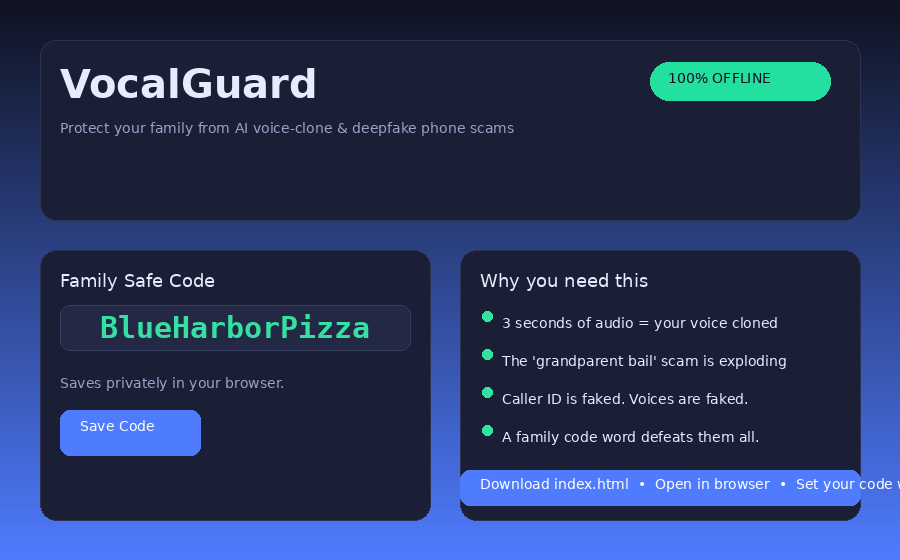

# 🛡️ VocalGuard

**Protect your family from AI voice-clone &amp; deepfake phone scams.**

A single, **100% offline** HTML file that gives every family a real defense against the fastest-growing scam in the world — callers who clone a loved one's voice to demand money.

**No install. No account. No data leaves your device.** Open it in any browser and you're done.

---

## ❓ The problem

AI can clone a convincing version of *your* voice from just **a few seconds** of audio — pulled from social videos, voicemails, or news clips. Scammers use this in the **"grandparent scam"**: they call elders pretending to be a child or grandchild in legal or medical trouble, demanding urgent money, gift cards, or crypto.

Caller ID can be spoofed. Voices can be cloned. Anyone — young, old, everyone — can be targeted.

## ✅ The fix (no tech required)

> **Trust the code word, not the voice or the number.**

A **family safe code word** that only your family knows defeats any audio clone, no matter how perfect. This tool makes setting that up fast, fun, and family-friendly.

---

## 🚀 Features

| Feature | What it does |
|---------|--------------|
| 🗝️ **Family Safe Codes** | Create or auto-generate a secret code word, saved privately in your browser. |
| 🎯 **Detection Quiz** | Interactive 6-question training so the whole family learns to spot clones — with clear explanations. |
| 📞 **Call Simulator** | Realistic scam scenarios ("grandchild in jail", "emergency wire", "don't tell anyone") with safe-response walkthroughs. |
| 🖨️ **Printables** | Print **wallet cards**, **phone posters**, and a **family safety plan** for elders, in one click (or save as PDF). |
| 🔒 **Private by design** | Everything runs in your browser. No tracking, no cloud, no servers. |

---

## 📥 How to use

1. **Download** [`index.html`](index.html).
2. **Open it** in any browser (double-click, or right-click → Open With → Browser).
3. **Set up** your family safe code word (Safe Codes tab).
4. **Do the quiz** together, and **print the cards &amp; posters** for the elders.
5. Done. You're now resistant to the #1 voice-scam attack.

> Works on desktop, tablet, and phone. Works offline with no internet at all.

---

## 📸 What it looks like

*(Add a screenshot at `assets/screenshot.png` if you'd like to show it off.)*

---

## 🧰 Built with

- Plain HTML + CSS + JavaScript — **zero dependencies**, no build step.
- `localStorage` for the code word — nothing ever leaves the device.

---

## 🤝 Contributing

Ideas welcome! A few directions that would make this even more useful:

- More Quiz scenarios &amp; translations (ES, AR, FR, etc.)
- Voice-sample "clone test" demo (educational only)
- More printable card layouts
- Checkbox-style safety plan that persists in localStorage

Please open an issue or PR. See [CONTRIBUTING](CONTRIBUTING.md).

---

## 📄 License

[MIT](LICENSE)

---

## ⚠️ Disclaimer

VocalGuard provides **awareness and family procedures**, not a technical guarantee. No tool can stop a determined scammer. Always verify identity with a code word and report suspected scams to local authorities and your national fraud/anti-fraud line.
